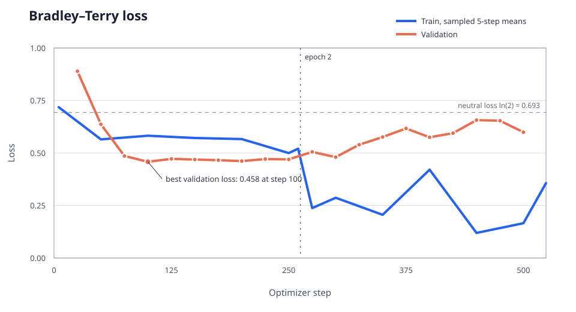
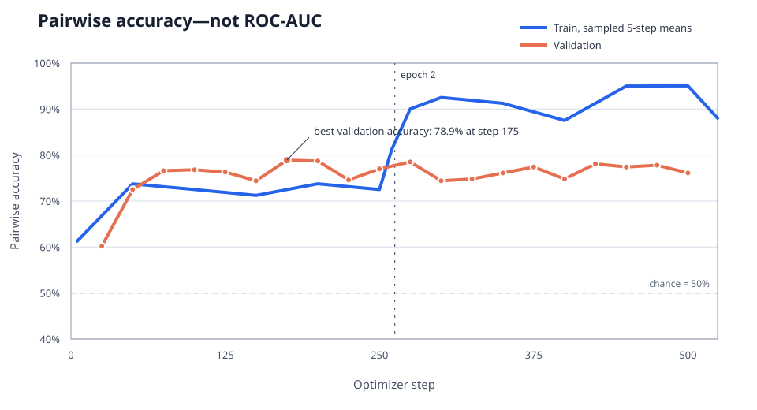
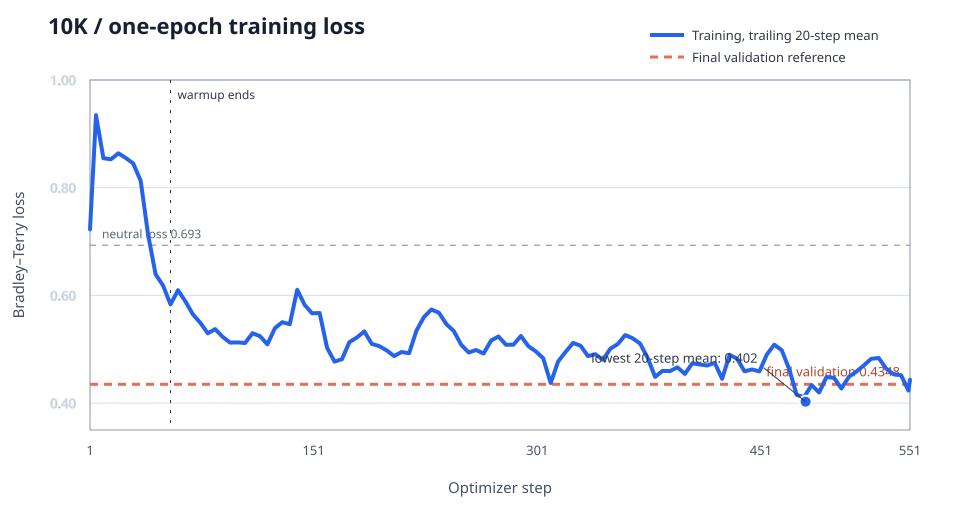
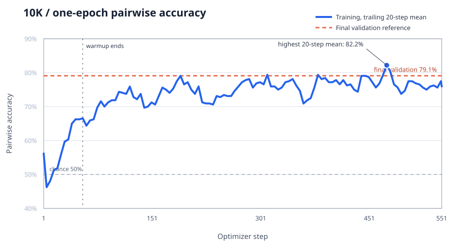

# Reward Models

## Preference RM, Outcome RM, and Process RM

Learning notes based on the `rlhf-book` examples and our Qwen3-0.6B preference-RM run.

---

# The shared idea

All three reward models use a language-model backbone as a contextual text encoder:

```text
prompt + response tokens
        ↓
transformer backbone
        ↓
contextual hidden states h₁ … hₜ
        ↓
task-specific reward head
        ↓
scalar or class scores
```

The prompt is always part of the context. The models differ in **what is labeled**, **which hidden states are scored**, and **which loss is optimized**.

---

# Three kinds of reward model

| Model | Training record | Directly scored states | Learns to answer |
|---|---|---|---|
| Preference RM | `(prompt, chosen, rejected)` | Final chosen and rejected states | Which complete answer is preferred? |
| Outcome RM (ORM) | `(prompt, response, pass/fail)` | Completion-token states in this implementation | Will this response ultimately be correct? |
| Process RM (PRM) | `(prompt, steps, step labels)` | Reasoning-step boundaries | Is each reasoning step valid or useful? |

---

# Preference RM: one training pair

```text
Prompt:   What is 3 + 2?
Chosen:   5
Rejected: 6
```

The same model performs two forward passes:

```text
[prompt + chosen + EOS]   → hᶜ_final → linear head → rᶜ
[prompt + rejected + EOS] → hʳ_final → linear head → rʳ
```

The linear head maps a contextual hidden vector to one scalar reward. Its initial weights are random; training updates the head and, in our run, the Qwen backbone.

---

# Preference loss

The Bradley–Terry preference probability is

$$P(\text{chosen wins}) = \sigma(r_c-r_r).$$

The negative log-likelihood loss is

$$\mathcal{L}=-\log\sigma(r_c-r_r).$$

Example: if $r_c=1.2$ and $r_r=-0.3$, the margin is $1.5$, the implied preference probability is $0.818$, and the loss is about $0.201$.

The loss does not try to make either absolute reward correct. It trains the **ordering and margin**: increasing $r_c-r_r$ decreases the loss, with diminishing returns.

---

# Why this loss?

It follows from a probabilistic model of pairwise human choices rather than being only an empirical trick:

1. Model each response with a latent scalar utility $r$.
2. Convert the reward difference into a probability with a sigmoid.
3. Maximize the likelihood of the observed preference.

This gives a smooth, differentiable objective and naturally treats the two rewards relatively. If the model ranks the pair incorrectly, the loss and corrective gradient are large.

---

# Attention masks, loss masks, and EOS

- **Attention mask:** prompt and response tokens are `1`; padding is `0`. It determines which tokens participate in attention.
- **Loss mask:** positions labeled `-100` are ignored by token-level loss. They can still influence later hidden states through attention.
- **EOS:** convenient, but not mathematically required. A final real token, a dedicated reward token, or a pooled representation can summarize the sequence.

For a sequence-level preference RM, only the final non-padding hidden state is sent to the reward head. Earlier prompt and response states still influence it causally.

---

# Outcome RM (ORM)

```text
Prompt:   What is 3 + 2?
Response: 5
Outcome:  1 (pass)

tokens: [prompt | response | EOS]
labels: [ -100  |   1 …    |  1 ]
```

For each labeled completion position, the hidden state produces an outcome logit and binary cross-entropy is computed against the final pass/fail label.

The prompt is not ignored: response hidden states encode it through causal attention. Only prompt positions are excluded from **direct** loss. No chosen/rejected pair is required.

---

# Process RM (PRM)

```text
[prompt | step₁ | END | step₂ | END | step₃ | END]
labels: [ -100 … +1   | -100 … 0    | -100 … -1   ]
```

At each step boundary, the corresponding hidden state is classified and cross-entropy is averaged over labeled steps.

`correct / neutral / incorrect` is common in datasets such as PRM800K, but it is not a universal definition. A PRM may instead be binary, use different categories, or generate textual critiques.

---

# Batch size 16 from microbatches of 2

Our configuration uses:

```text
microbatch size                 = 2 preference pairs
gradient accumulation steps     = 8 microbatches
effective batch per update      = 2 × 8 = 16 pairs
sequences processed per update  = 16 chosen + 16 rejected = 32
```

Each preference pair produces one Bradley–Terry loss, even though it requires chosen and rejected forward passes through the shared model.

---

# Loss and gradient accumulation

The first run used two preference pairs per microbatch:

$$L_j=\frac{\ell_{2j-1}+\ell_{2j}}{2}.$$

and accumulated eight scaled backward passes:

$$G \leftarrow G + \frac{1}{8}\nabla L_j.$$

The 10K run used one pair per microbatch, so $L_j=\ell_j$, and accumulated sixteen passes:

$$G \leftarrow G + \frac{1}{16}\nabla \ell_j.$$

`backward()` adds into one gradient buffer for every parameter. It does not preserve separate gradient objects, and the model weights remain unchanged until the optimizer step.

Both configurations therefore produce the same effective 16-pair gradient:

$$G=\nabla\left[\frac{1}{16}\sum_{i=1}^{16}\ell_i\right].$$

AdamW performs one `optimizer.step()`, then `zero_grad()` clears the buffers.

---

# First run: 5K pairs over two epochs

- Requested pairs: **5,000**
- Identical truncated pairs removed: **352**
- Training pairs: **4,183**
- Validation pairs: **465**
- Backbone: **Qwen3-0.6B-Base**
- Trainable parameters: **596.05M**
- Effective batch size: **16 pairs**
- Optimizer updates: **524** across two epochs

---

# Loss over training



Validation loss was best at step 100. During epoch 2, training loss continued falling while validation loss rose—evidence that confidence and overfitting increased.

---

# Pairwise accuracy over training



This metric is **pairwise accuracy**, $\mathbb{1}[r_c>r_r]$, not ROC-AUC. Validation accuracy peaked at **78.9%** at step 175 and ended near **76.6%**.

---

# What changed in the second run?

| Configuration | 5K run | 10K run |
|---|---:|---:|
| Requested pairs | 5,000 | 10,000 |
| Usable pairs after filtering | 4,648 | 9,276 |
| Train / validation pairs | 4,183 / 465 | 8,812 / 464 |
| Epochs | 2 | 1 |
| Microbatch × accumulation | 2 × 8 | 1 × 16 |
| Effective batch | 16 pairs | 16 pairs |
| Learning rate | $5\times10^{-5}$ | $5\times10^{-5}$ |
| Optimizer updates | 524 | 551 |

The update budget stayed nearly constant, but the 10K run used roughly twice as many unique training pairs instead of repeating the smaller dataset. Its smaller microbatch reduces activation memory but requires more forward/backward iterations per update.

---

# Second run: 10K pairs for one epoch

- Usable pairs: **9,276**
- Training pairs: **8,812**
- Validation pairs: **464**
- Warmup: **55 of 551 optimizer steps**
- Epoch training average: loss **0.5207**, accuracy **73.6%**
- Final validation: loss **0.4348**, accuracy **79.1%**, margin **1.4018**

Only the final validation measurement was logged, so it should be shown as a reference line—not interpreted as a validation curve over time.

---

# 10K run: loss



The trailing training mean continued improving through most of the epoch. The final validation loss of **0.4348** is below the first run's best logged validation loss of **0.4583**.

---

# 10K run: pairwise accuracy



Final validation accuracy reached **79.1%**, compared with the first run's best logged **78.9%** and final **76.6%**. Because the dataset size and validation split changed, this is encouraging rather than a perfectly controlled comparison.

---

# Comparing the two training strategies

| Validation result | 5K × 2 epochs | 10K × 1 epoch |
|---|---:|---:|
| Best logged loss | 0.4583 | — |
| Final loss | 0.6096 | **0.4348** |
| Best logged accuracy | 78.9% | — |
| Final accuracy | 76.6% | **79.1%** |
| Final reward margin | 2.5846 | **1.4018** |

The two-epoch run produced a much larger reward margin while validation loss worsened, indicating overconfidence. The one-epoch run ended with a smaller margin and better final validation metrics. More unique data plus no repeated epoch appears to generalize better, although intermediate validation checkpoints are needed to locate the true optimum.

---

# Main takeaways

1. The backbone encodes the complete prompt-response context; the head converts selected hidden states into reward or class scores.
2. Preference RM learns relative ordering from pairs; ORM learns final success from individual responses; PRM learns step-level quality.
3. A loss mask controls where direct supervision is applied—not which earlier tokens can affect a supervised hidden state.
4. Accumulating `2 × 8` or `1 × 16` produces the same 16-pair average gradient; `1 × 16` saves activation memory but is usually slower.
5. With a similar number of optimizer updates, one pass over roughly twice as many unique pairs generalized better than two passes over the smaller dataset.
6. The 10K run needs intermediate validation logging to determine whether its best checkpoint occurs before step 551.
